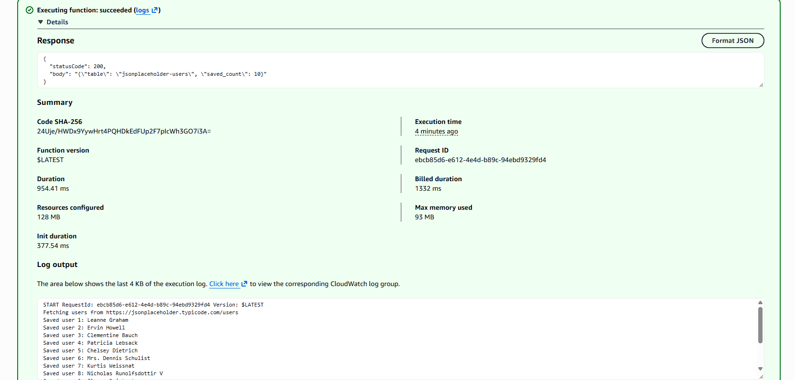
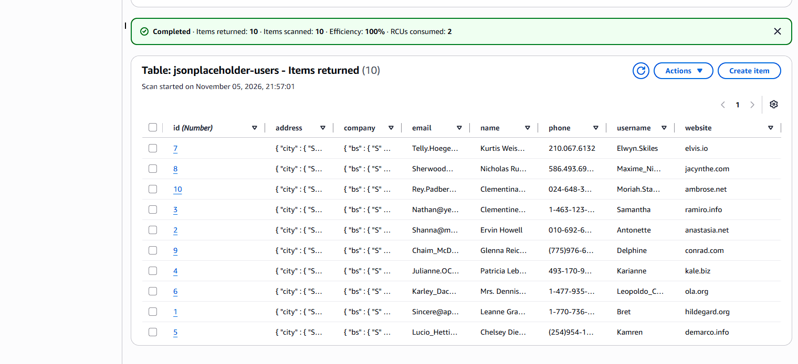
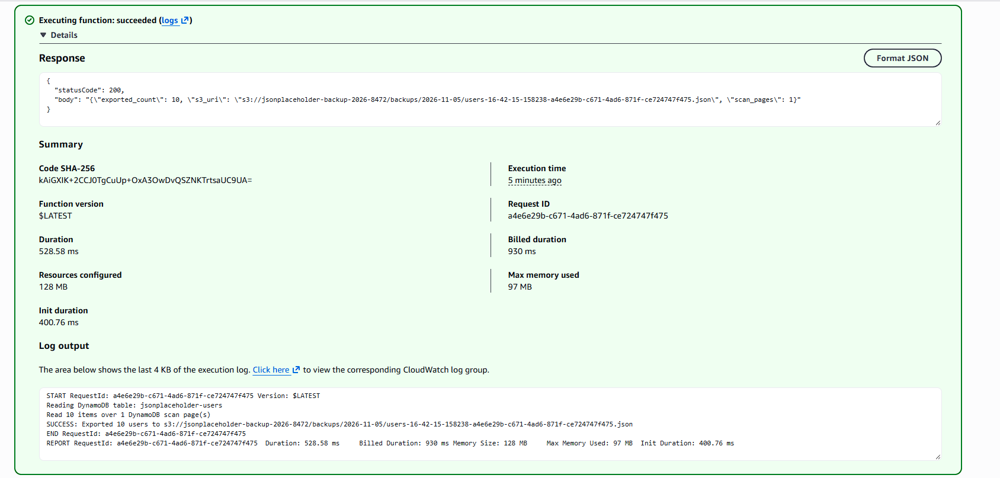
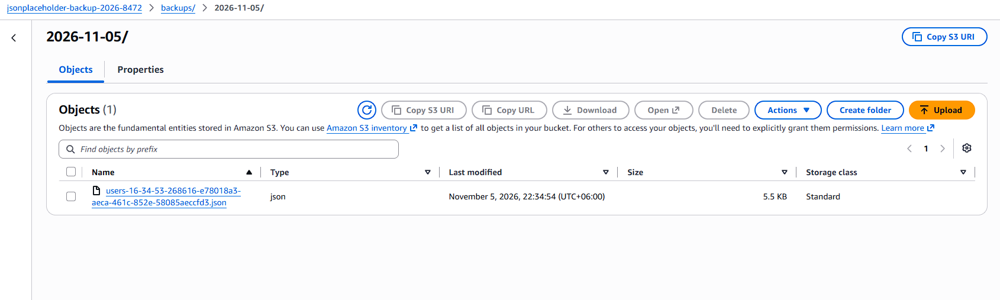
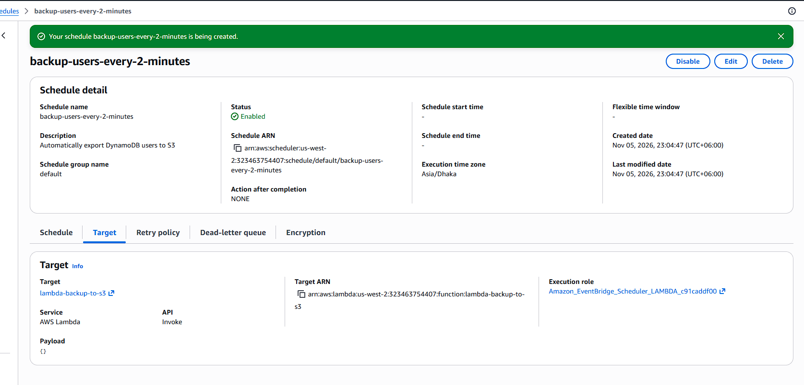
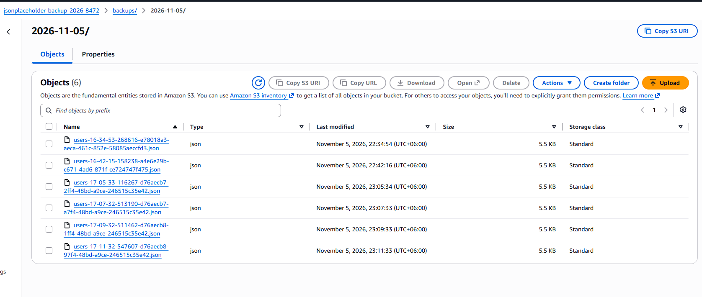
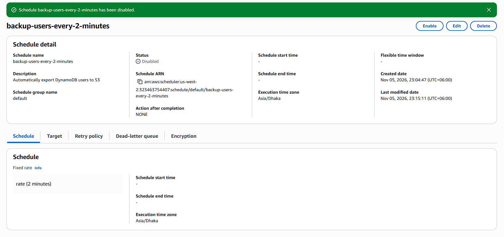

# AWS Serverless Data Pipeline

A hands-on AWS project that demonstrates how to build a serverless data pipeline using Python, AWS Lambda, Amazon DynamoDB, Amazon S3, and EventBridge Scheduler.

## 1. Project Overview

The objective of this project is to retrieve user data from an external REST API, store it in Amazon DynamoDB, and automatically export the stored records into JSON files in an Amazon S3 bucket.

The project focuses on serverless architecture, AWS service integration, IAM security, automation, and monitoring.

## 2. Architecture

The planned data flow is:

```text
JSONPlaceholder REST API
          |
          | HTTP GET
          v
     AWS Lambda #1
     (Import Users)
          |
          | DynamoDB PutItem
          v
      Amazon DynamoDB
          |
          | DynamoDB Scan
          v
     AWS Lambda #2 <----- EventBridge Scheduler
     (Export Users)        (Every 2 Minutes)
          |
          | S3 PutObject
          v
       Amazon S3
    (JSON Backup Files)

Both Lambda Functions
          |
          v
     Amazon CloudWatch
      (Logs & Metrics)
```

_This represents the intended architecture. Individual components and automated execution will be documented as they are implemented and verified._

## 3. AWS Services Used

| AWS Service           | Responsibility                                     |
| --------------------- | -------------------------------------------------- |
| AWS Lambda            | Executes Python functions without managing servers |
| Amazon DynamoDB       | Stores user records                                |
| Amazon S3             | Stores JSON export files                           |
| IAM                   | Controls service permissions                       |
| EventBridge Scheduler | Triggers recurring backup exports                  |
| Amazon CloudWatch     | Collects execution logs and metrics                |

## 4. Repository Structure

```text
aws-serverless-data-pipeline/
│
├── iam_policies/
│   ├── lambda-backup-export-policy.json
│   └── lambda-import-putitem-policy.json
│
├── lambda_src/
│   ├── backup_users/
│   │   └── lambda_function.py
│   └── import_users/
│       └── lambda_function.py
│
├── lambda_zips/
│   ├── lambda-backup-to-s3.zip
│   └── lambda-import-users.zip
│
└── README.md
```

## 5. Data Source

The project uses the JSONPlaceholder public REST API:

https://jsonplaceholder.typicode.com/users

The API provides sample user records containing information such as names, email addresses, addresses, and company details.

## 6. Implementation Screenshots

This section documents the AWS infrastructure implementation through screenshots captured during the development process.

### 6.1 Amazon DynamoDB Table Creation

Amazon DynamoDB is used as the database layer of this project to store user records retrieved from the JSONPlaceholder REST API.

**Table Configuration**

| Configuration | Value                   |
| ------------- | ----------------------- |
| Table Name    | `jsonplaceholder-users` |
| Partition Key | `id`                    |
| Key Type      | Number                  |
| Capacity Mode | On-demand               |

**Implementation Screenshot**


### 6.2 Amazon S3 Bucket Creation

Amazon S3 is used as the object storage layer of this project. It will store JSON backup files exported from the DynamoDB table by the second AWS Lambda function.

**Bucket Configuration**

| Configuration       | Value           |
| ------------------- | --------------- |
| Bucket Name         | jsonplaceholder |
| AWS Region          | us west -2      |
| Bucket Type         | General Purpose |
| Block Public Access | Enabled         |

**Bucket Creation Screenshot**


**Security Configuration**

The bucket security settings were configured to prevent public access and protect the stored backup data.


### 6.3 IAM Execution Role for the Import Lambda

I created `lambda-import-users-role` for the Lambda function that will import user records from JSONPlaceholder into DynamoDB. The function will use this role to access AWS services without storing IAM user access keys in its code.

**Role Configuration**

| Setting                    | Value                          |
| -------------------------- | ------------------------------ |
| Role name                  | `lambda-import-users-role`     |
| Trusted service            | AWS Lambda                     |
| Logging policy             | `AWSLambdaBasicExecutionRole`  |
| DynamoDB inline policy     | `lambda-import-putitem-policy` |
| Allowed DynamoDB operation | `PutItem`                      |
| Target table               | `jsonplaceholder-users`        |
| Table Region               | `us-west-2`                    |

The inline policy restricts DynamoDB writes to the `jsonplaceholder-users` table. `PutItem` can create a new record or replace an existing record with the same primary key. The separate logging policy allows the function to write execution logs to CloudWatch Logs.

**Execution Role Screenshot**


**DynamoDB Policy Screenshot**

### 6.4 Import Lambda Deployment and DynamoDB Data Insertion

After configuring the IAM execution role, I created and deployed the `lambda-import-users` function using Python 3.13.

The function retrieves user records from the JSONPlaceholder REST API and stores them in the `jsonplaceholder-users` DynamoDB table.

**Lambda Configuration**

| Configuration        | Value                              |
| -------------------- | ---------------------------------- |
| Function name        | `lambda-import-users`              |
| Runtime              | Python 3.13                        |
| Architecture         | ARM64                              |
| Handler              | `lambda_function.lambda_handler`   |
| Execution role       | `lambda-import-users-role`         |
| Environment variable | `TABLE_NAME=jsonplaceholder-users` |
| Memory               | 128 MB                             |

**Execution Process**

1. The Lambda function sends an HTTP GET request to JSONPlaceholder.
2. It receives and validates the JSON user records.
3. It connects to DynamoDB using the configured execution role.
4. It inserts each user record using the `PutItem` operation.
5. It logs the execution results in Amazon CloudWatch.

**Lambda Execution Result**

The first test invocation completed successfully.

| Metric               | Result    |
| -------------------- | --------- |
| Execution status     | Succeeded |
| Response status code | 200       |
| Records saved        | 10        |
| Execution duration   | 954.41 ms |
| Maximum memory used  | 93 MB     |



**DynamoDB Data Verification**

After execution, I scanned the `jsonplaceholder-users` table and verified that all 10 user records were present.

| Verification           | Result |
| ---------------------- | ------ |
| Items returned         | 10     |
| Items scanned          | 10     |
| Scan efficiency        | 100%   |
| Read capacity consumed | 2 RCUs |



### 6.5 DynamoDB JSON Export to Amazon S3

I deployed `lambda-backup-to-s3` to read user records from DynamoDB and export them as a JSON file to S3.

The function handles paginated DynamoDB scans and converts DynamoDB Decimal values into JSON-compatible values. Each filename includes a UTC timestamp and the Lambda request ID to distinguish separate executions.

**Configuration**

| Setting         | Value                              |
| --------------- | ---------------------------------- |
| Lambda function | `lambda-backup-to-s3`              |
| Execution role  | `lambda-backup-export-role`        |
| DynamoDB table  | `jsonplaceholder-users`            |
| S3 bucket       | `jsonplaceholder-backup-2026-8472` |
| Export prefix   | `backups/`                         |
| AWS Region      | `us-west-2`                        |

The execution role has `AWSLambdaBasicExecutionRole` for logging. Its inline policy, `lambda-backup-export-policy`, allows `dynamodb:Scan` on the users table and `s3:PutObject` only under the bucket’s `backups/` prefix.

**Manual Test Results**

I manually invoked the backup function from the Lambda console. The response and execution logs reported a successful export of 10 records.

| Result             | Observed value                         |
| ------------------ | -------------------------------------- |
| Status code        | `200`                                  |
| Records exported   | 10                                     |
| Scan pages         | 1                                      |
| Execution duration | 531.14 ms                              |
| S3 object size     | 5.5 KB                                 |
| S3 last modified   | November 5, 2026, 22:34:54 (UTC+06:00) |



**S3 Verification**

I confirmed that the JSON object appeared under `backups/2026-11-05/`. Its filename matches the object path reported by the Lambda execution.



### 6.6 Automated Backup Using Amazon EventBridge Scheduler

To automate the backup process, I configured Amazon EventBridge Scheduler to invoke the `lambda-backup-to-s3` function at regular intervals.

Instead of manually triggering the backup Lambda function, EventBridge Scheduler automatically invokes it every two minutes.

**\*\*EventBridge Scheduler Configuration\*\***

| Configuration | Value |
|---|---|
| Schedule Name | `backup-users-every-2-minutes` |
| Schedule Group | `default` |
| Schedule Type | Recurring |
| Schedule Expression | `rate(2 minutes)` |
| Time Zone | `Asia/Dhaka` |
| Target Service | AWS Lambda |
| Target Function | `lambda-backup-to-s3` |
| Payload | `{}` |
| Flexible Time Window | Off |
| Schedule Status | Enabled |

**\*\*Scheduler Configuration Screenshot\*\***



**\*\*Automated Backup Execution\*\***

After enabling the EventBridge schedule, the scheduler automatically invoked the `lambda-backup-to-s3` function every two minutes.

Each invocation scanned the DynamoDB table, retrieved the stored user records, converted them into JSON format, and uploaded a new backup file to the designated S3 bucket.

**\*\*S3 Backup Verification\*\***

I verified the automated backup process by checking the S3 bucket. Multiple timestamped JSON files were successfully generated and stored under the `backups/2026-11-05/` prefix.

The following backup files were generated during the automated execution:

| Execution Time (UTC+06:00) | File Size |
|---|---|
| 23:05:34 | 5.5 KB |
| 23:07:33 | 5.5 KB |
| 23:09:33 | 5.5 KB |
| 23:11:33 | 5.5 KB |



**Result:** EventBridge Scheduler successfully automated the backup process, eliminating the need for manual Lambda invocation. Each scheduled execution generated a separate JSON backup file in Amazon S3.

**\*\*Disabling EventBridge Scheduler\*\***

After verifying the automated backup executions, I disabled the EventBridge schedule to stop future scheduled invocations.

Disabling the schedule pauses automatic execution without deleting the Lambda function or previously generated backup files stored in Amazon S3.



## 7. What I Learned from This Project

Through this hands-on project, I gained practical experience integrating multiple AWS services to build a serverless data pipeline.

### Key Technical Skills

- **AWS Lambda:** Created, deployed, and tested Python-based serverless functions.
- **Amazon DynamoDB:** Learned NoSQL database creation, data insertion using `PutItem`, and data retrieval using `Scan`.
- **Amazon S3:** Configured object storage and automated JSON file uploads.
- **AWS IAM:** Created execution roles and custom policies following the principle of least privilege.
- **EventBridge Scheduler:** Implemented automated Lambda execution using recurring schedules.
- **Amazon CloudWatch:** Used logs and execution metrics to monitor Lambda functions.

### Practical Experience

- Used Boto3 to interact with AWS services programmatically.
- Managed environment variables and Lambda configurations.
- Handled DynamoDB pagination and Decimal-to-JSON conversion.
- Generated timestamped backup files to avoid overwriting existing objects.
- Verified automated workflows through AWS Console and execution logs.

### Key Takeaway

Developed a practical understanding of serverless architecture, AWS service integration, IAM security, Python automation, and event-driven computing by building an end-to-end automated data ingestion and backup pipeline.

